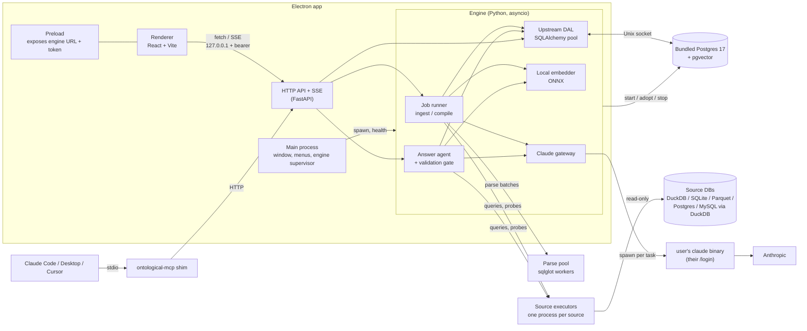

# Ontological: Architecture

Ontological is a local, single-user desktop tool. It builds a semantic ontology over your databases and answers natural-language questions against them with validated SQL. It is modeled on [NVIDIA/auto-ontology](https://github.com/NVIDIA/auto-ontology), studied at commit `2a24f5d` (2026-11-04), and differs from it in these ways:

| | auto-ontology (upstream) | Ontological |
|---|---|---|
| Deployment | Docker Compose / Helm: Next.js frontend, FastAPI server, ingestion worker, Postgres+pgvector, pgAdmin, two migration jobs; an MCP server (`mcp/`); optional Vault for connection secrets | One Electron app, one Python engine, and a bundled Postgres server that the engine starts and stops. The user installs nothing except Claude Code |
| Storage | Postgres 17 + pgvector; schemas `public`, `vdb`, `frontend`; Alembic + Prisma | The same Postgres 17 + pgvector, bundled. Upstream's `public` and `vdb` schemas and Alembic chain run unchanged, plus Ontological's `app` and `ops`. DuckDB reads the user's source data |
| Inference | NVIDIA NIM or an OpenAI-compatible endpoint, paid per token | The user's own Claude subscription, through their installed Claude Code. No API key, in any mode |
| Embeddings / rerank | NIM embedding + rerank endpoints | A local ONNX embedding model that ships inside the app; rerank dropped |
| Users | Better Auth, RBAC, SSO, groups, owners, OAuth server for MCP | One local user, no auth |

The document has three parts:
- **§1** explains what upstream does, in enough detail to port it.
- **§2–§10** are the design for Ontological.
- **§11–§13** cover reuse, the build plan and the risks.

---

## 1. How auto-ontology works

The system has three stages: **generate** an ontology from database metadata, let a human **certify** it, then **answer** questions grounded in it.

### 1.1 Ontology model

The ontology contains three kinds of definition, all stored relationally alongside the catalog they describe. Table names below are from upstream `auto_ontology/dal/schema.py`.

- **Term** (`term`): a business concept such as *Customer* or *Invoice Line*. It has a description, synonyms (`text[]`), `name_certified`/`description_certified`, and created/modified stamps. Terms map to tables through `table__term` (REPRESENTS, many-to-many).
- **Column attribute** (`column_attribute`): a named property of a term backed by one physical column. The links are `column__has_attribute` (column → attribute) and `column_attribute__term` (each attribute belongs to exactly one term).
- **SQL attribute** (`sql_attribute`): a reviewed SQL expression under a term, such as a margin, a filter or a bridge join. `source` is one of `manual | sql | table | bridgeTable`. It links to the query-history rows it was derived from (`sql_attribute__sql`).
- **Relationships**:
  - Declared FKs (`column__foreign_key`).
  - Inferred **semantic FKs** (`column__semantic_fk`: column → attribute it references, with `use_in_join_paths`).
  - Junction tables (`catalog_table.is_junction_table`).
  - Join paths are computed at query time by a Python BFS over the semantic-FK edges (`dal/attributes.py::find_join_path`).
- **Supporting entities**:
  - Custom analyses: named question + SQL, used as few-shot examples.
  - Tags, and rules (saved searches that auto-tag).
  - Zones (now just a view filter).
  - PII flags.
- **Certification** is a set of booleans that only humans set. Compilation never sets them, and retrieval never reads them. They exist for human trust, not for ranking.

The catalog tier (`catalog_database → catalog_schema → catalog_table → catalog_column`) carries the following:
- Column fields: data types, nullability, `sample_values` (JSON text), `is_unique`, and an inferred date `format`.
- Parsed query history: `sql_query` with structural fingerprints, plus links to the tables and columns each query touches, and column join/union edges.

### 1.2 Generate: ingestion

Code: `catalog/`, `ingestion_service/`, `connectors/`.

1. **Extract.** `connectors/base.py::SQLDatabase` defines the contract every connector implements (`get_tables/columns/views/pks/fks/queries`, `dialect`, `execute(timeout_s=)`). `catalog/extract.py` fails closed if a listed relation has zero columns.
2. **Normalize and diff.** `catalog/diff.py` diffs per schema, adding and deleting objects and refreshing types. Curated descriptions survive re-ingest. FKs are upserted with `last_seen` and stale ones are swept.
3. **Query history.**
   - Parsing: `catalog/sql_parse.py` and `parsers/sqlglot_extractor.py` use sqlglot to pull tables, columns, join pairs and union pairs from each query.
   - Dedup: a structural pre-filter followed by AST comparison.
4. **PII (optional).** Regex rules run on metadata only. An LLM classifies whatever the rules leave uncertain, and the result is tagged `PII`.
5. **Data-layer embeddings.** One text row per table and per column goes to the `data_objects_layer` pgvector collection. This collection is fully rewritten on every ingest.
6. **Scheduling.**
   - `DataScheduler`: runs at startup, then every 24h, or on trigger.
   - `SemanticScheduler`: gated by a config flag, and waits for the first ingest.
   - Both are in-memory asyncio loops inside a separate service on port 3002.

### 1.3 Generate: semantic compilation

Code: `semantic/compile.py`, `semantic/pipeline.py`, `semantic/visit_enter.py`.

- **Model and throttling.** Every generation-side LLM call uses the **REASONING** model at temperature 0, with at most 6 calls in flight. Tables run 3 at a time, and commits are serialized in a canonical order so that term-name collisions resolve the same way on every run.
- **Fallbacks.** Every LLM call has a deterministic fallback.
- **Incremental scope.** Only tables with no `table__term` row are compiled. The post-stages re-run on every pass.

**Per table:**

| # | Stage | Type | LLM calls |
|---|---|---|---|
| 1 | Profile: `SELECT * LIMIT 1000` gives uniqueness, top-5 values, DISTINCT probes for small enums, JSON key paths | deterministic, live DB | 0 |
| 2 | Date-format inference (`date_format.py`): `strptime` against about 23 patterns; ambiguous DD/MM yields nothing | deterministic | 0 |
| 3 | FK + PK + junction suggestion (`fk_suggester.py`): "be conservative" | LLM | 1 |
| 4 | Column descriptions for undescribed columns (`deterministic.py`) | LLM | ceil(n/15) |
| 5 | Term extraction (`term_extractor.py`): "strongly prefer ONE Term per table; assign EVERY column" | LLM | 1 |
| 6 | Synonyms, only words written in the table description | LLM | 0–1 |
| 7 | Commit terms/attributes; embed into the `semantic_layer` collection | deterministic + EMBED | 0 |

**Per database (post-stages):**

| Stage | Type | LLM calls |
|---|---|---|
| Semantic FK resolution (`semantic_fk.py`): declared-FK fast path; otherwise 2 vector searches + 1 LLM pick per unresolved column, then a live value-overlap probe, then pruning of disjoint edges | hybrid | 1 per unresolved column, + 1 per multi-source group |
| SQL attribute suggestion (`sql_attribute_suggester.py`): sqlglot pulls WHERE / aggregate / CASE fragments out of query history, an LLM judges them, then they are wrapped in a SELECT, validated by sqlglot, and embedded | hybrid | 1 per term with linked SQL |
| Bridge-table SQL attributes (`bridge_tables.py`) | LLM + RERANK | 1 per bridge |

**LLM plumbing** (`utils/llm_invoke.py`):
- Every call is `invoke_with_structured_output(llm, [System, Human], PydanticModel)`.
- Retries: 3 attempts. On a validation error, the error text is fed back into the next attempt. 429s get jittered backoff.
- On total failure it returns `None`.
- Upstream **already supports Claude**. For Claude models it uses function-calling mode and moves system messages to the front. The prompts are therefore known to work with Claude.

**Upstream bugs not to copy:**
- `_usage_score` is hard-coded to 0, so the "top 10" query fragments are simply in insertion order.
- Monthly query counters are written under one key name and read under another.
- The term prompt only sees the first 40 columns.
- A non-null LLM description overwrites the existing one, and there is no guard for certified descriptions.
- Data-layer embeddings are written before profiling fills `sample_values`.

### 1.4 Answer: the text-to-SQL agent

Code: `retrieval/text_to_sql/text_to_sql_graph.py`.

The agent is a LangGraph `StateGraph` used only as control flow. Each node is plain Python; there are no ReAct agents and no native tool binding. In order:

1. **Follow-up rewrite.** Turns the question into a standalone one. Runs only when there is conversation history.
2. **`question_intent`.** Classifies the question as information, prediction or calculation, picks one of 9 calculation subtypes (each with a SQL template), and pulls out inline evidence.
3. **`question_extraction`.** Extracts entities, the subject, and the glossary terms used.
4. **`retrieve_candidates`.**
   - Pure dense k-NN, filtered by `label` and `database_name`, over custom analyses, SQL attributes, column attributes (per entity) and terms.
   - Picks the target DB by entity coverage.
   - One LLM filter call over the hits.
5. **`prepare_candidates`.**
   - LLM picks the anchor attribute; BFS join paths are computed from it.
   - Linked tables are added and filtered by an LLM relevance check.
   - Junction and bridge tables the filter dropped are forced back in.
6. **`construct_sql_from_candidates`.** The **only REASONING call**. Returns `{thought, sql_code, response}`; the prose answer comes from this call.
7. **`validate_sql_query`.**
   - Deterministic checks: catalog resolution via sqlglot; rejection of degenerate SQL, vacuous GROUP BY, and missing aggregation on the many side.
   - Then an LLM **intent validation** that checks joins, aggregation, projection and evidence.
8. **`precheck_combined`.** Deterministic DB probes, capped at 40 per question:
   - **Literal check**: DISTINCT/MIN/MAX probes catch near-miss filter values.
   - **Join-path check**: every `JOIN ON` is checked against the semantic-FK graph.
   - **Case-dirty join check**.
   - **JSONB path check** (Postgres only).
9. **Execute** the query, then run **empty-result handling**: drop LIKE predicates, probe for value repair.
10. **`reconstruct_sql`** repair loop.
    - The first pass makes an error-analysis call (FIXABLE vs MISSING_DATA), then regenerates with all failed attempts in context.
    - Up to 7 attempts; soft checks are disabled after 5.
    - The whole pipeline restarts once if no SQL comes out.
11. **Format the response.** No LLM. Charts follow as 2 extra LLM calls that emit a JSON chart spec (bar / hbar / line / area / grouped-bar / delta / kpi).

**Cost per question:**
- Happy path: 6–9 LLM calls.
- With repairs: 10–15.
- Worst case: 40+.
- Plus 3–8 query embeddings. Rerank is not used here.

**`check_answerable`.** One extraction call, then vector search, then a deterministic score: the fraction of entities that have a column-attribute hit with cosine distance ≤ 0.75.

**Learning loop.** Nothing is automatic. Editing a custom analysis, a SQL attribute or a description re-embeds it, so it shows up in future retrieval.

**Streaming.**
- SSE event types: `step`, `sql`, `result`, `charts`, `error`.
- Runs execute in a pre-warmed subprocess pool, and a client can re-attach to a run with `/chat/watch`.
- Up to the last 5 turns are kept as history, and only the follow-up rewrite uses them.

### 1.5 Surfaces

- **Web UI** (Next.js): Chat, Discovery (search, saved as rules), Terms (glossary and certification), Analysis (saved SQL), Exploration (sigma.js + graphology ontology graph), Data (catalog tree), Analytics, Settings.
  - Charts are hand-rolled SVG driven by a JSON spec (`frontend/components/ResultChart/README.md`); worth borrowing.
- **REST**: 119 operations behind a Next.js gateway that injects a trusted user-id header.
- **MCP** (FastMCP, generated from the OpenAPI spec): `check_readiness`, `search_terms`, `get_term`, `get_term_columns`, `get_term_sql_attributes`, `get_sql_attribute`, `describe_table`, `check_answerable`, `ask_question`. All read-only.
- **Agent skills**: `nvidia-ontology-setup`, `-management`, `-query`.
- **Import/export**: native YAML and Apache Ossie, through the `apache-ossie-nvidia-auto-ontology` converter.

---

## 2. Goals and non-goals

**Goals**
- Answer quality comes first: make it as good as we can, measured on a fixed eval set (§12). Where quality and minimalism conflict, quality wins and the cost gets measured.
- Runs on one machine. The user installs Claude Code and nothing else: no Docker, and no servers to manage, because the app runs its own Postgres. Source data never leaves the machine except inside prompts sent to Claude.
- Inference runs only on the user's own Claude subscription (Pro, Max or Ultra), through their own Claude Code login. Ontological has no API-key mode.
- The core value matches upstream: generate, certify, answer, and expose over MCP. Answers carry validated SQL and visible provenance.
- An Electron UI for chat, ontology exploration, curation and settings.

**Non-goals (v1)**
- Multi-user, auth, RBAC, SSO, groups, owners, the OAuth server, Vault.
- Kubernetes and Docker deployment.
- Billing through the Claude API.
- KumoRFM predictions. It is a hosted service that uploads your tables, which conflicts with "local". Prediction questions get an explicit "not supported" answer (§8.1).
- The BIRD-Interact harness (`retrieval/interactive/`).
- Every upstream connector on day one (see §5.5).

---

## 3. Claude subscription: constraints that shape the design

Sources are the Claude Code docs, fetched 2026-11-04: `agent-sdk/overview`, `legal-and-compliance`, `authentication`, `headless`, `cli-reference` and `errors`.

**Policy.** The legal page says Anthropic does not permit third-party developers to:
- offer Claude.ai login in their own applications,
- route requests through Free, Pro, Max or Ultra plan credentials on behalf of their users,
- or collect, store or intermediate Claude.ai credentials or session tokens.

The same page also says this does not prevent "an end user from signing in to the unmodified Claude Code binary with their own Claude subscription."

**Hard rules for Ontological:**

1. **Spawn the user's own, unmodified `claude` binary, and rely on the login they already made with it** (`claude` → `/login`).
2. Ontological has **no login screen**. It never reads, stores, sets or forwards OAuth tokens, and never sets `CLAUDE_CODE_OAUTH_TOKEN`.
3. **Always strip `ANTHROPIC_API_KEY`, `ANTHROPIC_AUTH_TOKEN`, `ANTHROPIC_BASE_URL` and `CLAUDE_CODE_OAUTH_TOKEN`** from the child environment. In `-p` mode an API key takes precedence over the login, so a stray shell variable would silently bill API credits. If any of them is set in the user's shell, onboarding says once that Ontological ignores it.
4. **Never pass `--bare`.** Bare mode skips OAuth and the keychain, and the docs say it will become the default for `-p`, so set the mode explicitly instead.
5. **There is no API-key mode.** Subscription quota is the only budget. That sets the defaults in §6.3 and §8.1.
6. **Distribution.** Each user installs Claude Code and logs in to it themselves, and Ontological only spawns that unmodified binary. Personal use on your own machine matches the documented "end user with their own subscription" case. Before distributing the app to anyone else, re-read the policy and ask Anthropic, because the policy is written for third-party products. If the answer is no, Ontological stays a personal tool. There is no fallback.

**Technical facts the design depends on:**
- **Structured output.** `claude -p --output-format json --json-schema '<schema>'` returns the result in `structured_output`. The field is absent if validation fails, so always check for it. The Agent SDK equivalent is `output_format={"type":"json_schema", ...}`.
- **In-process tools.** The Python `claude-agent-sdk` provides `@tool` and `create_sdk_mcp_server`, which turn Python functions into in-process MCP tools that the model can call. Because the tools are Ontological's own Python, a tool can refuse to run and return an error the model reads. §8.1 builds on this.
- **Locked-down runs.** Built-in tools are disabled with `tools=[]` / `--tools ""`. User and project settings are skipped with `setting_sources=[]`. Since v2.1.302, `-p` defaults to a manual permission mode, so set `permission_mode` explicitly and deny everything Ontological doesn't provide.
- **Per-call cost.** Every `query()` spawns a `claude` process. Starting and closing it adds about half a second to each call (spike S2), on top of the model's own time. Upstream's pattern of many small calls is expensive here in both time and quota.
- **Limits are signalled in the stream.**
  - `RateLimitEvent.rate_limit_info`: `status` (allowed / allowed_warning / rejected), `resets_at`, `utilization`.
  - `AssistantMessage.error`: `authentication_failed`, `rate_limit`, `billing_error`, …
  - `system/api_retry` events.
  - There is no API for remaining quota.
- **No embeddings.** Anthropic has no embedding model, so embeddings run locally (§7).
- **Usage limits.** Subscription limits assume "ordinary, individual usage". A full compile of a large warehouse is not ordinary usage, so budgeting and resumability are first-class features (§6.5).

---

## 4. System overview



### 4.1 Processes

| Process | Language | Owns | Notes |
|---|---|---|---|
| Electron main | TypeScript | window, menu, file dialogs, engine supervision | Never touches Claude credentials. Attaches to a running engine or starts one, and holds a lease (§4.4). Restarts the engine on crash only if it started it. |
| Renderer | TypeScript / React | UI only | Talks to the engine directly over HTTP + SSE. CSP restricts `connect-src` to `http://127.0.0.1:<port>`. |
| Engine | Python 3.12 | jobs, answer agent, Claude gateway, embedder, the store connection pool, the Postgres lifecycle | Starts or adopts Postgres before serving requests, and stops it on shutdown (§5.3). |
| Postgres | bundled PostgreSQL 17 + pgvector | the store | Listens only on a Unix socket inside the app data folder. |
| Source executor | Python | one read-only source connection | One pre-warmed process per active source. Runs extract, profiling, gate probes and `run_sql`. Cancelling kills it and starts a new one (§5.6). |
| Parse pool | Python | nothing | `ProcessPoolExecutor` workers that parse query history with sqlglot. They never connect to the store. |
| `claude` (child) | the user's Claude Code | inference | One per task, spawned by the Agent SDK with `cli_path` pointing at the user's binary. |
| `ontological-mcp` | Python (same package, other entry point) | nothing | A thin stdio-to-HTTP shim for external agents. It attaches to the running engine, or starts one headless (which starts Postgres), and holds a lease on it (§4.4). |

### 4.2 Why a Python engine and not an all-TypeScript app

The upstream logic worth keeping is Python:
- the DAL and vector store (`dal/`, `catalog/store/`, `vdb/`; about 18,600 lines), which Ontological runs unchanged (§5.4)
- catalog extract and diff
- query-history parsing
- date-format inference
- profiling
- the literal, join-path and case-dirty-join probes
- catalog-resolution validation
- every prompt and Pydantic schema

Much of it leans on **sqlglot**, which has no TypeScript equivalent of similar depth. The Agent SDK has a Python package, DuckDB's Python bindings are first-class for reading sources, and local ONNX embedding (fastembed) is mature in Python. The cost is bundling a Python runtime into the Electron build (§10). An all-TS stack would mean rewriting the DAL and the validation layer, and the validation layer is the part that makes answers trustworthy.

### 4.3 Engine discovery and local security

- **Startup.** The engine binds `127.0.0.1` on a random port and generates a 32-byte bearer token. It writes `{pid, port, token, version}` to `<appData>/engine.json` with mode 0600. Electron and the MCP shim both read this file. Every request needs `Authorization: Bearer <token>`, so other local processes can't reach the API.
- **Postgres.** The server opens no TCP port (`listen_addresses = ''`). Its socket lives in `<appData>/Ontological/pgsocket/` with mode 0700, so only the OS user who runs the app can connect, and `pg_hba.conf` allows local socket connections only. Settings → External access can open `127.0.0.1` TCP with a generated password kept in the OS keychain, for pgAdmin, psql or DBeaver. It is off by default.
- **Source credentials.** Passwords for Postgres/MySQL sources are stored in the OS keychain through Python `keyring`. The store keeps only a keychain reference. This replaces upstream's plaintext JSONB plus optional Vault.

### 4.4 Engine lifetime

One engine serves every client: the Electron app, each `ontological-mcp` shim and the eval runner. A client that finds a live engine through `engine.json` attaches to it. Only a client that finds none starts one.

- **Leases.** Each client takes a lease from the engine (`POST /leases`) and renews it every 30 s. A lease that misses three renewals expires, which covers a client that crashed.
- **Idle shutdown.** An engine with no live leases, no requests and no running jobs for 10 minutes writes the quit dump, stops Postgres and exits. A paused job counts as running, so a compile waiting for a usage reset keeps the engine up.
- **Electron.** Quitting the app releases its lease and does not stop the engine. If MCP clients still hold leases, the engine keeps serving them; otherwise idle shutdown stops it. Electron's supervisor restarts the engine on a crash only if Electron started that engine.
- **Start-up race.** Two clients starting at once take an exclusive lock on `<appData>/engine.lock` before reading or writing `engine.json`, so only one starts an engine.

---

## 5. Storage: bundled Postgres for the store, DuckDB for sources

The store is upstream's own database: PostgreSQL 17 with pgvector, bundled in the app and run by the engine. DuckDB never holds Ontological's state. It only reads the user's source data. An earlier draft kept the store in one DuckDB file; §5.8 records why that changed.

### 5.1 Files

```
<appData>/Ontological/
  pgdata/                         # Postgres 17 data directory: the whole store
  pgsocket/                       # Unix socket directory, mode 0700
  backups/
    ontology-<ts>.dump            # pg_dump custom format: before each migration, after each compile, at quit
    ontology-<ts>.yaml            # native-YAML snapshot after each compile (§5.7)
  claude-sandbox/                 # empty cwd for spawned claude processes (see §6.2)
  engine.json
  logs/                           # engine.log, postgres.log
```

The Postgres binaries, DuckDB extensions and embedding model ship inside the app bundle (§10), not in `<appData>`.

### 5.2 Schemas

| Schema | Contents | Migrations |
|---|---|---|
| `public` | Upstream's catalog and semantic tables, unchanged: `catalog_database → catalog_schema → catalog_table → catalog_column`, foreign keys, query history, `term`, `table__term`, `column_attribute`, `column__semantic_fk`, `sql_attribute`, custom analyses, tags, rules | Upstream's Alembic chain (7 revisions at `2a24f5d`), vendored |
| `vdb` | Upstream's langchain-postgres vector tables, holding the `data_objects_layer` and `semantic_layer` collections | Created by upstream's `PostgresVDB`, with `vector_size` set to the bundled model's dimension |
| `app` | `conversation, message, setting(key, value JSONB), acronym, prompt_prefix, query_log` (replaces analytics) | Ontological's Alembic chain |
| `ops` | `job, job_step` (resumable compile checkpoints), `llm_call` (cache + usage log), `compile_run`, `change_log` | Ontological's Alembic chain |

Upstream's `frontend` schema (Prisma, Better Auth) is never created. App state lives in `app`, owned by the engine. The two Alembic chains are independent: Ontological's chain keeps its version table in `ops`, so new upstream revisions can be vendored without renumbering anything.

### 5.3 Running Postgres

- **Version.** PostgreSQL 17 with pgvector, matching upstream's `pgvector/pgvector:pg17` image. One major version ships at a time.
- **First launch.** `initdb` with UTF-8 encoding, locale `C`, and `trust` auth for local socket connections only (the 0700 socket directory is the access control). Then both Alembic chains run.
- **Start.** The engine runs `pg_ctl start` with `listen_addresses=''`, `unix_socket_directories=<pgsocket>`, `shared_buffers=128MB` and `max_connections=30`, then waits for `pg_isready`. After an OS crash, Postgres replays its WAL on start.
- **Adopt.** If the engine dies, Postgres keeps running. The next engine start reads `pgdata/postmaster.pid`. If that process is alive and is a postgres started from this data directory, the engine connects to it instead of starting a second server. A second engine never starts a second server: it finds the first engine through `engine.json`.
- **Stop.** `pg_ctl stop -m fast` on engine shutdown, after writing the quit dump. The engine shuts down when its last lease ends and it has been idle for 10 minutes (§4.4), or when the OS ends the session. If the engine is killed instead, the next start adopts the orphaned server or lets it recover.
- **Migrations.** A `pg_dump` runs before any pending revision is applied. A failed migration restores that dump.
- **Major-version upgrades.** A data directory only works with the major version that created it. Because the app writes a dump at every quit, a release that moves to a new major version detects the old `PG_VERSION`, moves `pgdata/` aside, runs `initdb` with the new version and restores the newest dump. If that dump is older than the last run (the app crashed before quitting), it says so before restoring. The old directory stays until the user deletes it. Deferred until the first major-version move: shipping the previous major's server binaries for one release, so the upgrade can dump the live data and nothing since the last dump is lost.
- **Disk.** If Postgres stops on a full disk, the engine reports it in the UI and pauses jobs. It never deletes backups on its own.

### 5.4 Reusing upstream's DAL

- Upstream's DAL and vector store (`dal/`, `catalog/store/`, `vdb/postgres.py`) run as-is through SQLAlchemy and psycopg against the bundled server. Upstream's golden fixtures (`dal/tests/golden/*.json`) and DAL tests are M2's conformance suite.
- **Golden seed.** The fixture graph is built by upstream's `dev_tools/fixtures/seed_graph_fixture.py`, which ingests Pagila as a Postgres source and Chinook as a SQLite file through upstream's own connectors, and writes through `server.sql_attributes.service` and `server.custom_analyses.service`. Seeding through Ontological's DuckDB path would change the catalog's type names and break the byte-for-byte comparison. So those connectors, the two service modules and the seed script are vendored as test-only code (§11), and the suite runs against a separate test cluster on the bundled Postgres binaries. The golden test skips when `POSTGRES_USER` is unset or the fixture is unseeded; CI treats any skip as a failure.
- **Ownership.** Rows keep their `owner_id` columns. Ontological writes one fixed local owner id, and the edit-permission checks in `dal/owners.py` and `dal/groups.py` are replaced by a stub that always allows. At `2a24f5d`, `dal/groups.py` is the only DAL module that reads the Prisma tables (`frontend."user"`), and no other DAL module imports `groups` or `owners`. DAL reads take `zone_ids=None`, which means the whole catalog.
- **Vectors.** `PostgresVDB` runs with `vector_size` set to the model's dimension. pgvector can build an HNSW index on plain `vector` up to 2,000 dimensions, so upstream's `halfvec` conversion (needed for Nemotron's 2,048) is skipped. The local embedder implements LangChain's `Embeddings` interface, which `PostgresVDB` expects.
- **Upstream bugs** listed in §1.3 are fixed in the ported stage code, not in the DAL.
- Edits to vendored upstream files stay small. Apache-2.0 requires modified files to say so, so each one gets a "modified by" line, and `NOTICE` lists them (§11).

### 5.5 Source databases

Sources are opened **read-only** and **never through the store**. Each active source gets its own source executor process (§5.6), which holds either a DuckDB connection (in-memory, with the source attached) or a native driver. A bad query can't touch the store, and source credentials never reach it.

| Source | Mechanism | SQL dialect Claude writes |
|---|---|---|
| DuckDB file, Parquet, CSV, JSON | `ATTACH '<file>' (READ_ONLY)` / `read_parquet` views | duckdb |
| SQLite | `ATTACH (TYPE sqlite, READ_ONLY)` | duckdb |
| Postgres, MySQL | DuckDB `postgres_scanner` / `mysql_scanner` attach, read-only | duckdb (executed by DuckDB over the remote tables) |
| Snowflake, Databricks, ClickHouse, Trino, … (later) | upstream connector classes behind the same `SQLDatabase` ABC | native |

Running Postgres and MySQL sources through DuckDB's scanners means the generated SQL is almost always in **one dialect (duckdb)**. That makes prompts, sqlglot validation and the probes simpler. The trade-off is weaker pushdown on very large remote tables. A per-connection "native" mode (`postgres_query()` passthrough, or the upstream psycopg connector) is the escape hatch.

Port `connectors/base.py::SQLDatabase` as-is, and finish the DuckDB reference connector. Upstream's `get_pks`/`get_fks` return empty and `table_type` is never read. Fill them from `duckdb_constraints()` and `information_schema.tables`.

### 5.6 Concurrency and process seams

**Store.** Postgres MVCC and row locks handle concurrent writes from ingest, compile and the API. Upstream's DAL already relies on this, through its `ON CONFLICT` upserts and `SELECT … FOR UPDATE` on conversation append, so there is no single-writer thread.

**Source executors (cancellation).** Native drivers such as psycopg, the Snowflake connector and Databricks block inside C, and a thread can't interrupt a blocked C call. Upstream solves this by running each chat in a subprocess it can kill. Ontological puts every source operation in a source executor: one pre-warmed subprocess per active source, holding that source's read-only connection. It runs extract, profiling queries and their statistics, date-format inference, `run_sql`, and `probe`: one capped, read-only query with a statement timeout, used by the gate's probes, empty-result handling and compile's semantic-FK value-overlap check. Cancel or timeout first tries `interrupt()` (DuckDB) or the driver's cancel call. If the query is still running 2 s later, the engine kills the process and starts a new one. DuckDB-backed sources go through executors too, so there is one code path. Results cross a pipe and stay small: at most 1,000 profiling rows or 200 answer rows.

**Parse pool (keeping chat responsive).** sqlglot parsing of query history is pure Python and holds the GIL, so running it in the engine would make chat and the UI sluggish during a large ingest. A `ProcessPoolExecutor` (spawn context, `min(cores - 1, 4)` workers) does the parsing and AST dedup. Workers never connect to the store. They return parsed structures and the engine writes them. The gate's sqlglot parse stays in the engine: it is one query per call and takes milliseconds.

**Embedder.** ONNX Runtime releases the GIL during inference, so the embedder runs on an engine thread. It takes work from a priority queue: query embeds from chat, `plan` and `check_answerable` go ahead of bulk compile batches, and bulk batches are capped in size so a query waits behind at most one of them. The BM25 index (§7.3) rebuilds off the request path and swaps in atomically, so searches never see a half-built index.

**Who does what.** The engine orchestrates every job and is the only process that writes the store.

| Work | Runs in | Reads | Writes |
|---|---|---|---|
| Extract, profiling, date formats | source executor | source | returns results to the engine |
| `probe` (gate, empty-result, semantic-FK overlap), `run_sql` | source executor | source | returns ≤ 200 rows to the engine |
| Query-history parsing and dedup, SQL-fragment extraction for SQL attributes | parse pool | query text sent by the engine | returns parsed structures to the engine |
| The gate's single-query sqlglot parse and catalog resolution | engine | store | nothing |
| Claude calls | engine, through the gateway | prompts built by the engine | `ops.llm_call` |
| Catalog, ontology, vectors, jobs | engine | store | store |

### 5.7 History

Upstream keeps no ontology history. Ontological adds:
- `ops.change_log(ts, entity, entity_id, field, old, new, actor)`, where actor is `user | compile | import`. It is written by the same functions that apply edits, and it drives undo and "what did compile change".
- A native-YAML snapshot written to `backups/` at the end of every compile run. This reuses the export code (§9.3).
- `pg_dump` files before migrations, after compiles and at quit (§5.1). Ontological keeps the newest 10 and removes older ones.

### 5.8 Why the store isn't DuckDB

An earlier draft put the store in one DuckDB file, for single-file backup and no server. Two findings reversed that:

1. **Porting cost.** Upstream's DAL is about 18,600 lines, and over 20 files use Postgres-only features: JSONB, arrays, pgvector, ILIKE, `on_conflict_do_update`. A DuckDB port means rewriting and re-testing all of it, and each rewrite risks behaviour drift that the quality goal can't afford.
2. **DuckDB foreign keys block curation.** DuckDB executes an update of an indexed or unique column as delete + insert, and the delete fails when a foreign key references the row. Spiked on DuckDB 1.4.5 (Python) and 1.5.4 (CLI), 2026-11-04:

   | Case | Result |
   |---|---|
   | Upsert the same key twice in one transaction; delete + reinsert; update then upsert | OK |
   | Update a non-indexed column of an FK-referenced row | OK |
   | Update a unique column of an FK-referenced row (renaming a term: `term.name_key`) | fails: "still referenced by a foreign key" |
   | Update, or `ON CONFLICT DO UPDATE`, an indexed column of an FK-referenced row | fails |

   The workaround is to declare no foreign keys and enforce integrity in code. Together with finding 1, that was more cost than reason to keep DuckDB.

DuckDB also allows only one process per file (no pgAdmin while the app runs), and its HNSW index persistence is experimental.

The costs of Postgres, accepted: a larger app (Postgres binaries are a few hundred MB before trimming), the lifecycle code in §5.3, major-version upgrades by dump and restore, and backups that are dumps rather than a file copy.

---

## 6. Claude gateway

`engine/ontological/llm/` is the only place that knows about Claude.

### 6.1 Interface

```python
class Route(NamedTuple):
    model: str    # CLI alias ("haiku" | "sonnet" | "opus" | "fable") or a full model ID ("claude-opus-5-5")
    effort: str   # "low" | "medium" | "high" | "xhigh" | "max"

class ClaudeGateway:
    routes: dict[str, Route]   # task -> route; defaults in §6.3, overridable in Settings
    async def structured(self, task: str, system: str, user: str,
                         schema: type[BaseModel],
                         cache_key_extra: str = "") -> BaseModel | None: ...
    async def text(self, task: str, system: str, user: str) -> str | None: ...
    def agent(self, task: str, system: str, tools: list[SdkTool],
              output: type[BaseModel], max_turns: int) -> AgentRun: ...  # async-iterable events + tool log
    status: GatewayStatus   # installed? logged in? limited until? utilization?
```

Callers name a task, never a model. The route table (§6.3) picks the model and effort for each task.

`structured()` keeps upstream's contract: return `None` on failure so the caller falls back deterministically. That lets the upstream stage code port with minimal changes. `agent()` is new; the answer path uses it (§8). `AgentRun` records every tool call in order, which the post-run check in §8.1 reads.

### 6.2 How a call is made

Each call runs `claude_agent_sdk.query()` with these `ClaudeAgentOptions`:

| Option | Value | Why |
|---|---|---|
| `cli_path` | resolved user `claude` (PATH lookup, then a settings override) | use the user's own unmodified, logged-in binary |
| `cwd` | `<appData>/claude-sandbox` (empty) | no project CLAUDE.md, files or git context leak in |
| `setting_sources` | `[]` | ignore user and project settings, hooks, plugins, MCP servers |
| `tools` | `[]` (structured) or only Ontological's SDK MCP tools (agent) | no Bash, Read, Write or WebFetch; source data in prompts can't trigger side effects |
| `permission_mode` | deny-by-default; `allowed_tools` = exactly the Ontological tools | unattended runs never hang on a prompt |
| `output_format` | `{"type":"json_schema","schema": Model.model_json_schema()}` | validated JSON; then `Model.model_validate(result.structured_output)` |
| `model` | `routes[task].model`, a CLI alias | aliases track the current models the CLI resolves (§6.3) |
| `effort` | `routes[task].effort` | thinking depth and token spend per task (§6.3) |
| `fallback_model` | `sonnet` for `opus` routes; unset otherwise | Opus overloaded or not on the user's plan (§6.3) |
| `max_turns` | 1–2 for structured, about 16 for agent | bound the spend |
| `env` | `os.environ` minus `ANTHROPIC_API_KEY`, `ANTHROPIC_AUTH_TOKEN`, `ANTHROPIC_BASE_URL`, `CLAUDE_CODE_OAUTH_TOKEN`, always; also minus the session variables a Claude Code parent sets, which an engine started by the MCP shim inherits: `CLAUDECODE`, `CLAUDE_CODE_ENTRYPOINT`, `CLAUDE_CODE_SESSION_ID`, `CLAUDE_CODE_CHILD_SESSION`, `CLAUDE_CODE_SESSION_ATTENDED`, `CLAUDE_CODE_MESSAGING_SOCKET`, `CLAUDE_CODE_MESSAGING_TOKEN`, `CLAUDE_CODE_EXECPATH`, `CLAUDE_CODE_AUTO_CONNECT_IDE`, `CLAUDE_CODE_ENABLE_TODO_TOOLS`, `CLAUDE_PID`, `CLAUDE_EFFORT` (the list spike S1 found in Claude Code 2.1.318). The SDK merges `options.env` over `os.environ` and can't remove a key, so the engine deletes these from its own `os.environ` at startup, and every call also sets the four auth variables to `""` in `options.env`, which `claude` treats as unset (S1) | §3 rule 3; a spawned `claude` must not behave as a nested session |
| session persistence | off | no transcripts piling up |

Retries follow upstream:
- If `structured_output` is missing or fails Pydantic validation, retry once with the validation error appended to the user turn.
- `rate_limit` or `overloaded` errors go to §6.5, not to a tight retry loop.

### 6.3 Which model does which job

Every Claude call names a task, and the route table maps each task to a model and an effort level. The rule is the cheapest model that does the job well:
- **Haiku** for extraction and classification, where the answer is already in the input.
- **Sonnet** for judgment over a short list of candidates, and for review.
- **Opus** where Claude writes something open-ended that later answers depend on: the answer SQL and bridge SQL.

**Relative cost.** Anthropic doesn't publish how subscription limits weight each model, so API prices are the best guide. Per million input / output tokens: Haiku 5.5 $0.10 / $0.50, Sonnet 5.5 $2 / $10, Opus 5.5 $4 / $20, Fable 5.1 $10 / $50. Haiku costs about a twentieth of Sonnet, and Opus costs twice Sonnet. Effort changes spend too: higher effort means more thinking tokens.

| Task | Job | Model | Effort | Calls |
|---|---|---|---|---|
| `table_keys` | split (default): PK, FK and junction suggestion | `sonnet` | `high` | 1 per table |
| `column_descriptions` | split (default): descriptions for undescribed columns, from names, types and sample values | `haiku` | `medium` | ⌈n/15⌉ per table |
| `table_terms` | split (default): term extraction, assigning every column, with the new descriptions as input | `sonnet` | `high` | 1 per table |
| `table_synonyms` | split (default): synonyms already written in the table description | `haiku` | `low` | 0–1 per table |
| `table_semantics` | merged (option): keys, descriptions, terms and synonyms in one call | `sonnet` | `high` | 1 per table |
| `semantic_fk_pick` | pick the referenced attribute from the top-3 candidates | `sonnet` | `medium` | 1 per ~25 columns |
| `sql_attribute_judge` | keep or drop query-history fragments, and name them | `sonnet` | `medium` | 1 per batch of terms |
| `bridge_sql` | write a bridge table's join SQL and pick its owning term | `opus` | `high` | 1 per bridge |
| `pii_classify` | classify uncertain columns from metadata | `haiku` | `low` | 1 per ~40 columns |
| `answer_agent` | plan, write and repair the SQL, write the answer and chart | `opus` | `medium` | 1 session per question |
| `answer_review` | critic: does this SQL answer this question? | `sonnet` | `medium` | 1–2 per question |
| `answerable_extract` | extract entities for `check_answerable` | `haiku` | `low` | 1 per check |
| `ping` | onboarding round-trip | `haiku` | `low` | once |

Why these choices:
- **The answer agent gets Opus** because it writes the SQL the user sees. Upstream makes the same split: only `construct_sql_from_candidates` uses its reasoning client, and upstream's default Claude config points that client at Opus 5.5.
- **The answer agent starts at `medium` effort**, Opus 5.5's own default. Thinking tokens are about half of a question's estimated usage, and the gate catches many of the mistakes extra thinking would. The first tuning round tests `high`, and it becomes the default only if it scores clearly better (docs/BUILD_PLAN.md).
- **The critic runs on Sonnet, not Haiku.** Its job is catching SQL that is valid but wrong, which is the hard case. A Haiku critic that misses it still costs a spawn. Using a different model from the author also makes the check more independent.
- **Split puts the bulk stages on Haiku.** Column descriptions are the highest-volume compile call, and they move to Haiku. Split makes several times as many calls as merged, but the estimated quota is only about 1.5–2 times merged's: the two Sonnet calls per table carry the judgment, and the Haiku calls cost about a twentieth as much. M3 measures the real ratio (§12).
- **Fable 5.1 is not a default.** It costs 2.5 times Opus, always thinks, and can run for minutes per turn, which doesn't suit interactive chat. Users can select it for `answer_agent`.

Rules:
- Every route is a setting (Settings → Models). The eval (§12) tries the answer routes one step cheaper; compile routes one step cheaper are judged by the compile-quality review and the retrieval benchmark, which cost no quota. A route moves down when the cheaper model scores the same, and moves up when it loses accuracy.
- `opus` routes set `fallback_model="sonnet"`, so an overloaded Opus, or a plan that doesn't offer Opus, still gets an answer. Nothing falls back to Haiku: silently downgrading a judgment call is worse than waiting. Each answer records the model that actually ran: the `AssistantMessage.model`, which after a fallback is the fallback model, announced by a `system`/`model_fallback` message. `ResultMessage.model_usage` can also list Claude Code's own side calls on Haiku, so it is not the record of which model answered (S1).
- Under quota pressure the gateway lowers concurrency and pauses background jobs (§6.5). It never switches models on its own.
- **Resolved models.** Aliases follow new releases. The SDK's `init` message reports the concrete model for each session, and the result message reports usage per model. `ops.llm_call` stores both. The cache key uses the route's model string as written, so with an alias a model release doesn't force a recompile of unchanged tables. Jobs offers "recompile with current models" for when the user wants one. Eval configs pin full model IDs instead, so a release can't land in the middle of a comparison, and the eval report lists the resolved IDs it ran.

### 6.4 Fewer, bigger calls

Upstream was written for a cheap, fast HTTP endpoint and makes many small calls. Here every call is a process spawn charged against a shared quota, so the work is restructured:

| Upstream | Ontological |
|---|---|
| Per table: FK suggestion (1) + column descriptions (⌈n/15⌉) + term extraction (1) + synonyms (0–1) | **Default `split`: upstream's four calls, in upstream's order, on tiered models** (§6.3). Keys and terms run on Sonnet, descriptions and synonyms on Haiku. Term extraction sees the finished descriptions, as upstream's does. Tables with ≤ 6 columns are **packed several to a call** within each stage (up to about 8k tokens of input). Columns beyond prompt capacity are chunked instead of truncated at 40. **Option `merged`:** one `TableSemantics` call per table returning `{pk, fk_suggestions, is_junction, column_descriptions[], terms[], synonyms[]}`, built from the same four prompts as sections. It is for very large schemas where split would take many usage windows. The setting is `compile.table_calls`, and the pre-compile estimate shows both options (§6.5). |
| Semantic FK: 1 call per unresolved column | **1 call per batch of about 25 unresolved columns**, each with its top-3 retrieval candidates; then upstream's deterministic overlap probe and pruning |
| SQL attribute judge: 1 call per term | 1 call per batch of terms (fragments are short) |
| Bridge owner via RERANK | Claude picks the owner inside the bridge-SQL call |
| PII LLM fallback: 1 call per uncertain column | 1 call per batch of about 40 uncertain columns, metadata only (unchanged) |
| Answer: 6–15 separate calls | One Opus agent session plus 1–2 Sonnet review calls (§8.1) |

**Caching.**
- Every structured call is keyed by `sha256(task, prompt_version, model, effort, system, user, schema)` and logged in `ops.llm_call` with usage. `model` is the route's alias or pinned ID (§6.3). Effort is in the key because it changes the output. A recompile of unchanged tables costs nothing.
- Prompt templates carry an explicit `prompt_version`, so editing a prompt invalidates only that task's cache.

**Concurrency.** A global semaphore limits in-flight Claude processes. The default is 3; it is a user setting.

### 6.5 Quota, errors and resumability

**Quota.**
- The gateway tracks the latest `RateLimitEvent` (status, utilization, `resets_at`) and shows it in the UI as a usage meter. Claude Code 2.1.318 leaves the SDK's `utilization` field empty; the value is per window in `rate_limit_info.raw["unifiedWindows"][<window>]["utilization"]` (S1).
- `allowed_warning`: compile jobs drop to concurrency 1. Interactive chat keeps priority over background compile.
- `rejected` / `rate_limit`: the job runner **pauses** background jobs until `resets_at` and resumes on its own. Chat shows "usage limit reached, resets at …".

**Errors.**
- `authentication_failed` or "Not logged in": status becomes `needs_login`. The UI tells the user to open a terminal, run `claude` and type `/login`. Ontological never runs that flow itself.
- `claude` not found: onboarding links to Claude Code installation.

**Resumability.**
- Compile is checkpointed per table in `ops.job_step`. A paused or crashed compile resumes where it stopped.
- **A pre-compile estimate** is shown before starting: calls ≈ ⌈tables / packing⌉ + ⌈unresolved FK columns / 25⌉ + …, so the user can scope to schemas or tables first.
- The estimate shows both `split` and `merged`, with calls, estimated quota and estimated time, so the user can pick `merged` for a very large run.
- A rough guide, unverified until measured: a 200-table database needs about 600–900 compile calls with `split` (the same order as upstream) and about 120–220 with `merged`. Split's quota is estimated at about 1.5–2 times merged's, because most of its extra calls run on Haiku. Starting and closing the `claude` process adds 0.53 s to each call at p50 (spike S2, the same on every model), so at the default concurrency of 3, split's 480–680 extra calls add about 1.5–2 minutes of process overhead. The model's own time per call, which grows with the prompt, is most of the difference. Compile runs in the background, and results are cached, so only new or changed tables pay again.

**Version drift.**
- On startup the engine runs `claude --version` and checks for a minimum version.
- Contract tests (§12) cover `structured_output`, the SDK MCP tool round-trip, and the shape of rate-limit events.

---

## 7. Embeddings and retrieval

### 7.1 A local model, with nothing to set up

Anthropic has no embedding model, so the embedder runs on the user's machine. It ships inside the app and loads on its own: no first-run download, no configuration, and the app works offline from install. Docker would add setup instead of removing it.

The runtime is **fastembed** (Apache-2.0) on ONNX Runtime (the macOS arm64 wheel is 20.9 MB). If fastembed doesn't support the chosen model, the engine loads the ONNX file with `onnxruntime` and `tokenizers` directly, which is about 50 lines of code.

- Upstream embeds asymmetrically (`input_type=query|passage`). Use the model's query/passage prefixes where it defines them.
- Every vector's metadata stores `model` and `content_hash`. Changing the embedding model triggers a re-embed job; vectors from different models are never compared.
- **Fix upstream's ordering bug**: build data-layer texts *after* profiling so that `sample_values` are included.

### 7.2 Choosing the model

Upstream uses NVIDIA's 2,048-dim Nemotron embedder, which is larger than any model Ontological would bundle. Whether a small local model matches it can only be measured, but three things should keep the gap small here:
- The corpus is small and literal: up to about 10⁵ short texts of table names, column names, descriptions and synonyms. Much of the matching is vocabulary, which lexical search handles well (§7.3).
- Upstream retrieves once. If dense search misses the right column, the answer is wrong. Here the agent sees the grounding pack, and when something is missing it calls `search_ontology` with its own wording. A miss costs a turn instead of the answer.
- The `plan` tool reruns retrieval per entity as upstream does (§8.1), so the agent adds a second chance without dropping upstream's first one.

A small model is most likely to hurt on paraphrase: questions matched against saved analyses ("top spenders" against "customers by total revenue"), and `check_answerable`, whose threshold depends on the embedder.

Candidates (ONNX files and licenses checked on Hugging Face, 2026-11-04):

| Model | Dim | ONNX size | License |
|---|---|---|---|
| `bge-small-en-v1.5` (Qdrant int8 build) | 384 | 66.5 MB | MIT |
| `snowflake-arctic-embed-m-v1.5` int8 | 768 | 110.1 MB | Apache-2.0 |
| `nomic-embed-text-v1.5` int8 | 768 | 137.3 MB | Apache-2.0 |
| `bge-base-en-v1.5` fp32 | 768 | 435.8 MB | MIT |

The default is `snowflake-arctic-embed-m-v1.5` int8 until the retrieval benchmark (§7.4) runs. After that, it is the model with the best recall. A smaller model wins only on a tie; app size is not the deciding factor.

Dropping embeddings entirely was considered and rejected. It would save 66–440 MB and lose the paraphrase cases above. Semantic-FK candidate search would survive on name matching plus the value-overlap probe, but few-shot retrieval and `check_answerable` would get worse in ways that are hard to measure.

### 7.3 Hybrid search

Upstream's answer-side retrieval is dense k-NN only. Its trigram indexes (`gin_trgm_ops`) serve the UI search box, not retrieval, and its own schema comments explain why it avoided Postgres full-text search there: `tsvector` only matches from the start of a token. Business vocabulary ("revenue", "SKU", acronyms) and identifiers (`cust_acct_no`, `InvoiceLineID`) need lexical matching, so Ontological fuses three rankings with reciprocal-rank fusion:

```
score = rrf( dense_rank(embedding <=> query_vec),                 # pgvector
             bm25_rank(name + synonyms + description),            # in-engine BM25
             trgm_rank(similarity(name, query)) )                 # pg_trgm: typos, partial names
         + certified_bonus
```

- **BM25 runs in the engine** with `bm25s` (MIT) over at most about 10⁵ short documents. The index is rebuilt after each compile, import and edit. At this size a rebuild should take about a second; spike S8 measures it (docs/BUILD_PLAN.md). Rebuilds swap in atomically (§5.6).
- **Identifier-aware tokens.** Before indexing and querying, identifiers are split on snake_case and camelCase, and glossary acronyms (Settings → Glossary) are expanded. `cust_acct_no` matches "customer account number".
- **Why not BM25 inside Postgres.** `ts_rank_cd` is not BM25 and has the start-of-token problem. ParadeDB's `pg_search` is BM25 but AGPL-3.0. Timescale's `pg_textsearch` is BM25 under the PostgreSQL license, but it is one more native extension to build, sign and upgrade per platform. Revisit it only if the in-engine index becomes a bottleneck.
- Fusion runs in Python over the three ranked lists. It keeps upstream's filters (collection, label, database_name) and its `{text, metadata, distance}` result contract, so ported upstream code works unchanged.
- Certified items get a small RRF bonus and are labeled "certified" in the grounding pack (§8.3).

**Recalibrate thresholds.** Upstream's coverage threshold (cosine distance ≤ 0.75) and its k values are tuned to Nemotron and won't transfer. Re-derive them per model on the eval set (§12).

### 7.4 Retrieval benchmark

The benchmark costs no quota after one compile. For each eval question, sqlglot extracts the gold tables and columns from the gold SQL. The benchmark then measures recall@k of the grounding pack for each configuration: dense only, BM25 only, trigram only and hybrid, for each candidate model.

### 7.5 Rerank

Dropped. Upstream used it only to pick a bridge table's owning term at build time, and that choice now happens inside the bridge call.

---

## 8. The answer agent

### 8.1 Shape: a gated agent

One Agent SDK session per question. Upstream's fixed graph guaranteed that extraction, retrieval, the anchor pick, validation, the intent critic and the probes always ran. A free-running agent can skip any of them. Ontological keeps the single session and enforces those steps through **tool preconditions**: each tool checks what has already happened in the session and refuses, with a readable error, if a required step is missing.

```
question
  │
  ├─ pre-work (Python, no LLM):
  │    follow-up context (last 5 turns), hybrid retrieval with the raw question over terms /
  │    attributes / SQL attributes / custom analyses, target database (the caller's scope, or
  │    the best entity coverage as upstream), BFS join paths among the top tables
  │    →  "grounding pack" (≈ upstream prepare_candidates output)
  │
  └─ ClaudeGateway.agent(task="answer_agent", max_turns≈16, output=AnswerModel, tools=[…]):   # Opus, §6.3
        system prompt = upstream SQL-generation rules + dialect rules + calculation subtypes + grounding pack
        final output (json_schema): AnswerModel{answer, sql, plan_id, validation_id, review_id,
                                                assumptions[], terms_used[], answerable: bool,
                                                missing[], chart?: ChartSpec}
```

**Tools**

| Tool | Precondition | What it does |
|---|---|---|
| `plan(intent, calc_subtype?, entities[], evidence[], anchor_attribute_id?, database?)` | none; must be the first call | Records what upstream's `question_intent` and `question_extraction` produced, and the target database: the scope if one was given, otherwise the model's choice from the grounding pack's coverage ranking. Later tools work against that database only. The engine runs upstream's per-entity retrieval for those entities, computes BFS join paths from the anchor, and returns the candidates plus the subtype's SQL template. Returns a `plan_id`. |
| `search_ontology(query, kinds?)` | none | Hybrid search for more candidates |
| `get_term(id)`, `describe_table(id)` | none | Detail |
| `join_path(from_table, to_table)` | none | BFS over semantic FKs |
| `column_values(column, like?, limit)` | none | DISTINCT/MIN/MAX probe, read-only and capped |
| `validate_sql(sql)` | a `plan_id` exists | The §8.2 gate. Returns ok + `validation_id`, or a list of issues. At most 7 calls per session, as upstream; after 5, the soft checks (literal, case-dirty join) become warnings, as upstream. |
| `run_sql(validation_id)` | the id passed `validate_sql` | Executes in the source executor and returns columns + ≤ 200 rows. **On an empty result it runs upstream's empty-result handling** (drop LIKE predicates, value-repair probes) and returns the hints with the zero rows. |
| `review_answer(validation_id, answer_draft)` | the id was executed; critic enabled | Runs upstream's intent-validation prompt as an `answer_review` `structured()` call (Sonnet, §6.3) on (question, plan, SQL, columns, first rows). Returns pass, or issues for the model to fix. At most 2 rounds. Returns a `review_id`. |

**Post-run check.** After the session, the engine reads the tool log and confirms the sequence plan → validate → run → review for the final SQL. If any step is missing or the ids don't match, the answer is shown as "unverified" with the reason; it is never silently accepted. The required sequence depends on the session: `information` answers need only `plan`; with the critic off, review is not required; an answer with `answerable=false` needs a `plan` and no SQL.

**Source scope.** Chat has a source selector that defaults to "auto", which lets pre-work pick the database by coverage. MCP's `ask_question` and the eval runner can pass a scope; the eval passes each question's database. A question is answered from one source; cross-source SQL is out of scope.

**Intents.**
- `calculation`: the full sequence above.
- `information` ("what tables hold customers?"): `run_sql` and `review_answer` are withheld. This replaces upstream's separate 13-tool `information_agent` loop.
- `prediction`: `plan` returns "not supported", and the session must end with `answerable=false, missing=["prediction_unsupported"]`. The UI says Ontological doesn't do predictions. This replaces upstream's Kumo route.

**Restart.** If a session ends without validated SQL, the engine runs one fresh session, as upstream restarts its graph once.

**Critic default.** `answer.critic` is on, because upstream always runs intent validation. If the eval shows it doesn't change accuracy, it becomes opt-in.

**Trade-offs against upstream:**
- **Cost.** One Opus session plus 1–2 Sonnet review calls: 2–4 process spawns instead of 6–15 HTTP calls. Claude Code handles prompt caching across turns. Repairs need no extra spawns: the model sees `validate_sql` issues and fixes the SQL in the same context, which replaces `reconstruct_sql` and its error-analysis call.
- **Determinism** comes from the preconditions and the gate, not from a fixed graph. The residual risk is that the model completes every step with thin inputs, for example a vague plan. The critic and the eval are the checks on that.
- **Charts** come from the same session (`chart` field, ResultChart spec), not from 2 more calls. A single-row result is forced to `kpi` deterministically, as upstream does.

### 8.2 The validation gate (ported from upstream)

`validate_sql(sql)` runs these checks in order. All are deterministic, and the probes go to the source read-only:

1. Parse with sqlglot in the source dialect. Exactly one `SELECT`/`WITH` statement is allowed; DML, DDL, `ATTACH`, `COPY`, `PRAGMA`, `INSTALL` and `LOAD` are rejected.
2. Resolve every table and column against the catalog (`parse_query_single`).
3. Degenerate SQL (`SELECT NULL`, `WHERE 1=0`, `LIMIT 0`), vacuous GROUP BY / PARTITION BY, and missing aggregation on the many side.
4. Join-path check against semantic FKs, with a value-overlap fallback probe. Includes the case-dirty join check.
5. Literal check: near-miss filter values and percent-vs-fraction scale errors.
6. JSON path check. For duckdb-dialect sources it is **rewritten for DuckDB** (`json_keys` / `->>`) in place of the Postgres-only `jsonb_object_keys` version; native Postgres sources keep upstream's version.
7. Drop Postgres-only rewrites (mixed-case identifier quoting, `DISTINCT ON` rejection) when the dialect is duckdb.

Limits:
- Probes are capped (40 per question, as upstream). They run in the source executor with a statement timeout, and a probe that overruns gets the executor killed (§5.6).
- `run_sql` appends a LIMIT and runs on the per-source read-only connection.

### 8.3 Other answer-side features

- **`check_answerable(question)`.** Hybrid retrieval plus one `answerable_extract` call (Haiku, §6.3) for entity extraction, then upstream's deterministic coverage score with the recalibrated threshold (§7.3). Exposed in the UI as a pre-check and over MCP.
- **Learning loop**, kept and made explicit:
  - A thumbs-up on an answer offers "Save as analysis". That creates a custom analysis (question + SQL), which is embedded and retrieved as a worked example in future questions.
  - Editing a term or SQL attribute re-embeds it.
  - Unlike upstream, **certified items are boosted in retrieval** (§7.3). This makes certification affect answers.
- **Conversation state.** The engine stores turns in `app.message`; each question starts a fresh session with a compact history block. This avoids depending on Claude Code's session files.

### 8.4 Event stream to the UI

Upstream's SSE contract is kept so its UI patterns can be borrowed: `step` (tool calls and model thinking summaries, mapped from SDK messages), `sql` (only after `validate_sql` passes), `result`, `chart`, `error`, `usage` (new: rate-limit status).

Runs are keyed by conversation and buffered so the UI can re-attach after a reload (upstream `/chat/watch`). Cancel aborts the SDK query, which kills the `claude` child, and cancels any source query in flight, killing the executor if needed (§5.6).

---

## 9. Surfaces

### 9.1 Electron UI

The visual design, components, screen rules and UI states are in [DESIGN.md](DESIGN.md).

Stack:
- React 19 + Vite + TypeScript, TanStack Query, Tailwind.
- sigma.js + graphology + d3-force for the ontology graph, as upstream.
- A port of upstream's ResultChart (SVG, JSON spec).
- Monaco or CodeMirror for SQL. Upstream uses textareas.

| Screen | From upstream | Changes |
|---|---|---|
| **Onboarding** | new | Claude Code detection (installed / logged in / version), a note if API-key variables are set and ignored, first source, scope picker, compile estimate |
| **Chat** | `/chat` | steps timeline, SQL with "validated" badge, rows grid + CSV, chart, "Save as analysis", usage meter, "not supported" for prediction questions |
| **Ontology** | `/exploration` | data and semantic layers, term-to-term path highlight; click a node to edit it in a side panel |
| **Terms** | `/terms` | glossary, synonyms, attributes, SQL attributes, certification, change history from `ops.change_log` |
| **Catalog** | `/data` + `/discovery` | tree + detail + search; tags and rules kept, simplified |
| **Analyses** | `/analysis` | saved SQL analyses only (PQL dropped) |
| **Jobs** | Settings → Semantic Compilation | ingest and compile runs, per-table progress, pause/resume, LLM-call log and cache hits, reset (with backup) |
| **Settings** | Settings | Sources (keychain-backed), Models (model and effort per task, concurrency), Answer (critic on/off), Compile (`split` by default or `merged`, auto-compile), Embeddings (model, re-embed), PII toggle, Glossary/acronyms, Prompt prefixes, Import/Export, External database access, Backups, MCP setup snippet |

**Staleness check instead of a 24h timer.** Upstream's scheduler re-ingests every 24h, but a desktop app is often closed. On engine start, any source last ingested more than 24h ago gets its metadata re-ingested, which costs no quota. If that finds new tables, Jobs shows "N new tables, compile?" and waits. Auto-compile is a setting, off by default.

Dropped: login, invitations, users, groups, SSO, API tokens, owners, zones (or keep zones as a saved filter later), admin analytics (replaced by a personal `query_log`).

### 9.2 MCP for external agents

`ontological-mcp` is a stdio server. It is configured in Claude Code with `claude mcp add ontological -- ontological-mcp`, and similarly in Claude Desktop and Cursor. It proxies to the engine API, starting a headless engine (and with it Postgres) if none is running, and holds a lease while the MCP client is connected (§4.4). It answers MCP `initialize` at once and starts the engine in the background, because Postgres start-up and model loading take longer than MCP clients wait for a handshake. Tool calls made before the engine is ready wait for it.

It exposes upstream's curated set (`check_readiness`, `search_terms`, `get_term`, `get_term_columns`, `get_term_sql_attributes`, `get_sql_attribute`, `describe_table`, `check_answerable`, `ask_question`) plus two tools that matter when the caller is itself Claude:
- **`validate_sql(sql)`** and **`run_validated_sql(validation_id)`**. These let a calling Claude Code session do the reasoning itself against Ontological's gate, without spending a second nested agent session through `ask_question`.

Port upstream's three skills as one Claude Code plugin (`plugins/claude-code/`): query, manage and setup. Rebrand them and point them at the stdio tools and engine API.

### 9.3 Import/export

- Keep upstream's **native YAML** schema (`server/model_interchange/schemas.py`).
- Keep **Ossie** through the Apache-2.0 `apache-ossie-nvidia-auto-ontology` converter, pinned to a commit.
- Extend the native format to carry synonyms and certification, which upstream drops.
- Import runs in one transaction. Re-embedding happens afterwards as a tracked job, so a failure is visible and can be retried. Upstream lets vectors silently diverge.

---

## 10. Packaging and repository layout

```
ontological/
  apps/desktop/                 Electron (electron-vite)
    src/main/                   window, engine supervisor, engine.json reader, menus
    src/preload/                exposes {engineUrl, token} only
    src/renderer/               React app (§9.1)
  engine/                       Python package `ontological` (uv-managed)
    ontological/
      api/                      FastAPI routes + SSE
      upstream/                 vendored upstream DAL, vdb and Alembic chain, run as-is   (§5.4)
      store/                    pg.py (initdb, start, adopt, stop, dump/restore), migrations/ (Ontological's chain),
                                local_owner.py (owner/group stub), backups
      sources/                  SQLDatabase ABC, duckdb/sqlite/scanner connectors, executor.py, keyring refs
      catalog/                  extract, normalize, diff, query-history parsing, parse_pool.py   (ported)
      profile/                  sampling, date_format, json paths (run inside the executor)     (ported)
      compile/                  stages, merged/split call shapes, batching/packing, checkpoints
      pii/                      rules (ported) + batched Claude fallback
      embed/                    ONNX embedder (LangChain Embeddings interface), BM25 index + tokenizer, hybrid search, retrieval benchmark
      answer/                   grounding pack, agent tools + preconditions, validation gate, probes (ported)
      llm/                      ClaudeGateway, route table, cache, limits, prompts/ (versioned)
      interchange/              native YAML + Ossie
      mcp/                      stdio shim
      jobs/                     runner, staleness check, pause/resume
    tests/
      upstream_fixtures/        test-only vendored upstream connectors, services and golden seed (§5.4)
  eval/                         frozen question-set IDs, runner, verifier, control arm (docs/BUILD_PLAN.md)
  tools/spikes/                 spike scripts kept for re-runs
  plugins/claude-code/          skills + plugin manifest
  docs/
  THIRD_PARTY_NOTICES.md, NOTICE
```

**Build.**
- The engine is built into a self-contained runtime: `uv` + python-build-standalone, or a PyInstaller one-dir build. It ships in `extraResources` per platform (macOS arm64/x64 first).
- **PostgreSQL 17 + pgvector** ship in `extraResources` per platform. CI builds pgvector against the same Postgres build, keeps `bin/` (`postgres`, `initdb`, `pg_ctl`, `pg_isready`, `pg_dump`, `pg_restore`, `psql`), `lib/` and the needed parts of `share/`, and drops docs and headers. The binaries are signed and notarized with the app. The prebuilt untrimmed macOS arm64 package (`@embedded-postgres/darwin-arm64`) is 337 MB unpacked; M0 measures the trimmed size. Size is not a blocker.
- DuckDB extensions for sources (`postgres_scanner`, `mysql_scanner`, `sqlite_scanner`, `json`) are bundled and loaded from `extension_directory` with autoinstall off, so the app works offline.
- The embedding model is bundled (§7.1).
- **Claude Code is not bundled.** It is a prerequisite that the user installs and logs into, which keeps the "unmodified binary, user's own login" property clear.

---

## 11. Reuse plan from upstream

Upstream is Apache-2.0. For vendored and ported files:
- Keep the SPDX headers and add a "modified by" line to every file Ontological changes.
- Carry over `LICENSE`, `NOTICE` and the relevant `THIRD_PARTY_NOTICES` entries, plus PostgreSQL's and pgvector's licenses for the bundled binaries.
- Remove NVIDIA branding: names, `#76b900`, logos, `nvidia-` skill names, and `@nvidia/foundations-react-core`. Apache-2.0 grants no trademark rights.
- Don't ship the vendored kumo wheels (closed `.so`, hosted service).

| Upstream path | Action |
|---|---|
| `dal/*`, `catalog/store/*`, `vdb/postgres.py`, `alembic/` | **Vendor and run as-is** against the bundled Postgres. Stub owners/groups with the local owner; set `vector_size` to the model's dimension |
| `dal/tests/golden/*.json` and the DAL tests | Run unchanged as M2's conformance suite |
| `dev_tools/fixtures/seed_graph_fixture.py`, `capture_dal_golden.py`, upstream's Postgres and SQLite connectors, `server/sql_attributes/service.py`, `server/custom_analyses/service.py` | **Vendor as test-only code** under `engine/tests/upstream_fixtures/`, used only to seed the golden fixture (§5.4). Never imported by the engine |
| `connectors/base.py`, `connectors/duckdb.py`, `connectors/sqlite.py` | Port; complete PK/FK/table_type for DuckDB; run inside the source executor |
| `catalog/extract.py`, `normalize.py`, `diff.py`, `sql_parse.py`, `parsers/*`, `query_stats.py` | Port; fix the month-counter key; query-history parsing runs in the parse pool |
| `semantic/visit_enter.py` (profiling), `date_format.py` | Port as-is; run inside the source executor |
| `semantic/*` prompts + Pydantic schemas | Port the content. Keep the four per-table prompts for `split`, and combine them as sections for `merged` (`TableSemantics`); chunk past 40 columns |
| `semantic/semantic_fk.py`, `bridge_tables.py`, `sql_attribute_suggester.py` | Port the deterministic parts; batch the LLM parts; fix `_usage_score` |
| `pii_detection/rules.py` | Port as-is; batch the LLM fallback |
| `retrieval/text_to_sql/db_probe/*`, `agents/sql_parse_validation.py` (deterministic parts), `server/sql_utils.py` | Port: they become the §8.2 gate |
| `retrieval/text_to_sql/agents/sql_from_semantic.py` prompts, `calculation_subtypes.json` | Reuse the prompt content in the agent system prompt and the `plan` tool |
| Intent-validation prompt (`validate_sql_query`'s LLM step) | Reuse in `review_answer` |
| `retrieval/text_to_sql/agents/candidates_*.py`, `dal/attributes.py::find_join_path` | Port the retrieval and BFS logic as pre-work and the `plan` tool |
| `retrieval/text_to_sql/text_to_sql_graph.py`, `reconstruct_sql`, LangGraph, LangChain LLM clients | Replace with the gated agent session. langchain-postgres stays, for `PostgresVDB` |
| `retrieval/entity_coverage/agents/coverage.py` | Port (deterministic) |
| `server/model_interchange/*`, `dal/model_interchange.py` | Port; extend the format |
| `frontend/components/ResultChart/*`, `explorationPage/graph/*` | Port to the Electron renderer |
| `mcp/auto_ontology_mcp/tools.py` descriptions, `INSTRUCTIONS` | Reuse the text in the stdio shim |
| Better Auth, Prisma, Vault, pgAdmin, `retrieval/kumo`, `retrieval/interactive`, Helm, Docker | Drop |

---

## 12. Build plan and verification

The ordered tasks, spikes and dependencies for these milestones are in [docs/BUILD_PLAN.md](BUILD_PLAN.md). Change a milestone here and there together.

| Milestone | Scope | Done when |
|---|---|---|
| **M0 Spikes and engine skeleton** | Spikes S1–S9 (docs/BUILD_PLAN.md), headless engine, `engine.json` and leases (§4.4), bundled Postgres lifecycle (initdb, start, adopt, stop, dump), both Alembic chains, `ClaudeGateway.structured()`, the frozen eval set | Every spike has a recorded result; a structured "ping" round-trips with env sanitization verified (no API key or Claude Code session variable reaches the child); after `kill -9` of the engine, the next start adopts Postgres with no data loss; trimmed Postgres size measured; `eval/sets/*.json` frozen and every gold query runs |
| **M1 Thin vertical slice** | Headless and on Chinook: vendored DAL, one source executor, minimal ingest and split compile, dense retrieval, the gated agent with gate checks 1–3 and the critic, `ontological ask`, the eval runner with the control arm | `ontological ask` answers a Chinook question through plan → validate → run → review; precondition and post-run-check tests pass; `ontological eval smoke` produces a score; per-question usage measured (spike S3) |
| **M2 Catalog depth and Electron shell** | Golden DAL suite, all v1 sources in executors, extract/diff, full profiling, query history in the parse pool, staleness check, Electron shell, onboarding and catalog screens | Upstream's golden DAL fixtures and DAL tests pass against the bundled Postgres with no skips; re-ingest is idempotent; cancelling a long source query kills and restarts its executor; API requests stay responsive during a large query-history ingest; onboarding detects `claude`, its version and login state; WWI and the four BIRD eval databases ingest |
| **M3 Compile depth** | Full split stages, merged option, semantic FKs, SQL attributes, bridges, PII, hybrid search, checkpoints and pause/resume, estimate, jobs screen, retrieval benchmark | Every eval database compiles end-to-end; killing the engine mid-compile resumes without redoing finished tables; a second compile makes ~0 Claude calls (cache). **Compile-quality review** on Pagila and WWI: a hand-reviewed sample of terms, FKs and descriptions, split vs merged and compile routes one step cheaper, with quota and time per compile. If merged is no worse, it becomes the default. **Retrieval benchmark** run, the default embedding model chosen and thresholds recalibrated |
| **M4 Answer depth and tuning** | Gate checks 4–7, probes, empty-result handling, the full tool set, intents, restart, `check_answerable`, SSE, chat screen, charts, the first tuning round | The first tuning round and the held-out run are recorded in docs/BUILD_PLAN.md, and the §6.3 defaults match the winner. No answer is shown as verified without the sequence §8.1's post-run check requires |
| **M5 Curation** | Term editing, certification boost, change log, save-as-analysis, personal eval cases | Edits re-embed and change retrieval; renaming a term works; undo from `change_log` works; a saved answer runs as a personal eval case |
| **M6 Interop** | MCP stdio shim, Claude Code plugin, YAML/Ossie import-export | Claude Code can answer via `ask_question` and via `validate_sql` + `run_validated_sql`; with the Electron app closed, the shim's engine shuts down after its idle timeout |
| **M7 Package** | Signed macOS build with bundled Postgres, extensions and model; offline start | Clean-machine install works with only Claude Code installed; a simulated major-version upgrade restores from the quit dump |

**Tests.**
- **Gateway contract tests.** Run against the real CLI, behind a flag: `structured_output` present and valid, SDK MCP tool round-trip, rate-limit event parsing, and "not logged in" detection.
- **Postgres lifecycle tests.** First launch, normal stop, engine `kill -9` then adopt, stale `postmaster.pid`, a second engine instance, failed migration then restore, major-version restore.
- **Deterministic suites.** Ported from upstream's tests: the DAL tests and golden fixtures, `test_literal_check`, `test_case_dirty_join_check`, `test_jsonb_path_check` (plus a DuckDB variant), and the catalog diff tests.
- **Agent precondition tests.** Each tool refuses when its precondition is missing, and the post-run check marks an answer "unverified" when the sequence is incomplete.
- **Retrieval benchmark** (§7.4): recall@k per model and per configuration; runs without quota once a compile exists.
- **Answer-quality eval.** A small set of our own, detailed in docs/BUILD_PLAN.md: about 80 dev questions (all 41 Wide World Importers questions plus about 40 from four BIRD Mini-Dev databases), about 40 held-out and 20 smoke. BIRD `evidence` is included; BIRD's description files are not ingested. The data and BIRD's execution-accuracy rule come from [ontology-sql-eval](https://github.com/NVIDIA/ontology-sql-eval/); its harness, which runs upstream in-process, is not used.
  - Track execution accuracy, the share of answers verified by the gate, and spawns, turns, tokens and quota used per question.
  - A schema-only control arm (one call per question, no tools, same model) shows what the ontology adds. It runs once per model.
  - Usage is a budget. Day-to-day runs use the smoke set with the agent on Sonnet. A tuning round is 3 dev runs (baseline, critic off, agent on Sonnet; the first round adds `high` effort) plus one held-out run for the winner. Compile settings are judged by the compile-quality review and the retrieval benchmark, which cost no quota.
  - No comparison run against upstream. The goal is the best score on this set, not parity with a baseline.

---

## 13. Risks and open questions

**Risks**

1. **Subscription policy for distribution.** Personal use matches the documented case. Shipping the app to others needs a policy re-read and probably a conversation with Anthropic. There is no API-key fallback: if the answer is no, Ontological stays personal.
2. **Quota on large schemas.** Even with batching, a 1,000-table warehouse is a lot of calls for a Pro plan, and the default `split` costs an estimated 1.5–2 times `merged`'s quota. Hitting the limit pauses compile until the reset rather than failing it. Mitigations: scope picker, estimate, cache, pause-until-reset, Haiku for the bulk stages (§6.3), and `merged` for very large runs.
3. **Agent vs. fixed graph.** Tool preconditions force upstream's steps and the critic is on by default. The remaining risk is a model that completes every step with thin inputs. The eval measures it.
4. **Local embedding quality.** Every bundled candidate is smaller than Nemotron. Hybrid search, certified boosts, per-entity retrieval in `plan` and the agent's own `search_ontology` calls compensate. The retrieval benchmark and the end-to-end eval measure it, and a larger bundled model is the fallback.
5. **DuckDB scanner pushdown.** Large remote Postgres/MySQL tables may be slow through scanners. A per-connection native mode is the escape hatch.
6. **Claude Code CLI drift.** Flags, defaults (e.g. `--bare` becoming the default) and event shapes change. Pin a minimum version, set every relevant option explicitly, and run the contract tests on CLI upgrades.
7. **Prompt injection from data.** Sample values and descriptions go into prompts. The agent has no built-in tools, only read-only, capped, single-statement SQL tools on read-only connections, so the worst case is a wrong answer, not a side effect.
8. **Running Postgres inside a desktop app.** Orphaned servers after crashes, a second app instance, a full disk and major-version upgrades. §5.3 handles each one, and the lifecycle tests cover them in M0 and M7.
9. **Coupling to upstream's DAL.** Vendoring means upstream changes arrive as merges. Local edits stay small and listed, and the golden fixtures catch drift.
10. **Eval precision.** The eval set is kept small to save quota, so with about 80 dev questions only differences of about 10 points stand out from noise. Close calls go to the cheaper configuration, and personal eval cases from the user's own data (M5) add questions over time.

**Open questions**

None right now. The remaining choices (embedding model, model routes, the critic, split vs merged) are settings that the M3 and M4 measurements decide.
